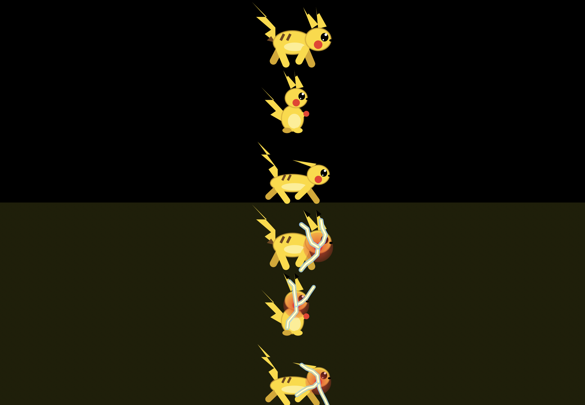
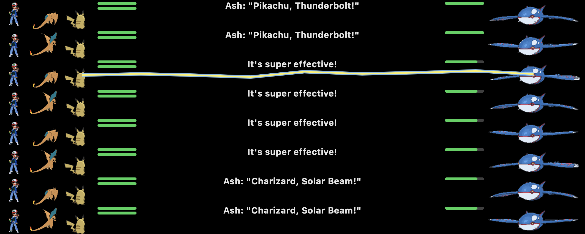

# touchbar-buddy

A tiny pet and battle arena that lives on the MacBook Pro Touch Bar.

- A hand-drawn electric mouse sits in the Control Strip. Tap him and he zaps.
- He crawls, sits and nibbles a berry, sprints with his ears back, blinks, and sparks from his cheeks.
- The arena runs an endless double battle (Pikachu and Charizard, commanded by Ash, against Kyogre) using the real type chart: super effective, not very effective, fainting, a winner, then a rematch.




## Run

```sh
./fetch-sprites.sh                 # downloads battle sprites to ./sprites (not included, see below)
swiftc -O main.swift Battle.swift -o buddy
./buddy &
```

Tap the pet in the Control Strip to reopen the arena after closing it with the X.
`./buddy --snap` and `./buddy --battle-snap` write preview images to `/tmp`.

Needs a Mac with a Touch Bar. It uses private DFRFoundation calls (the same ones MTMR and Pock use), so a macOS update can break it.

## Sprites and trademarks

The battle sprites are not in this repo. `fetch-sprites.sh` downloads them from Pokemon Showdown for personal use on your own machine.
Pokemon and all character names are trademarks of Nintendo, Creatures Inc. and GAME FREAK inc. This is an unofficial fan project, not affiliated with or endorsed by them. Screenshots are shown for illustration only.

## License

Code: MIT. The MIT license does not cover any Pokemon artwork or characters.
